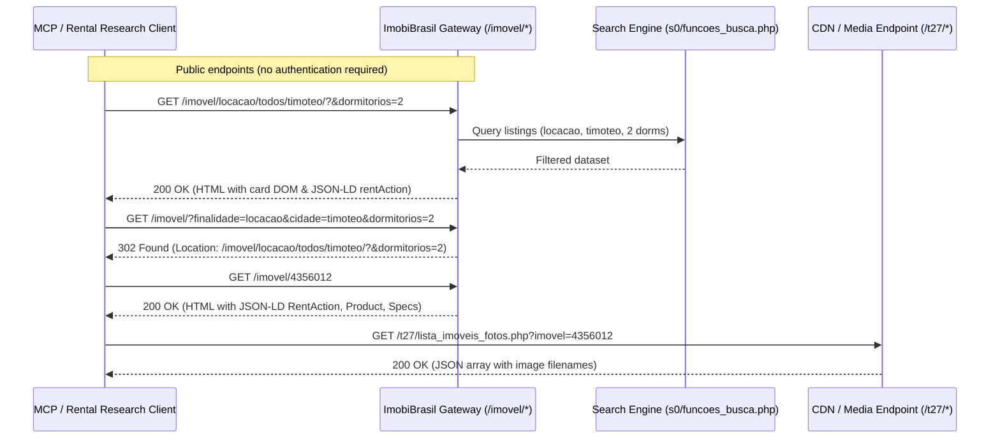
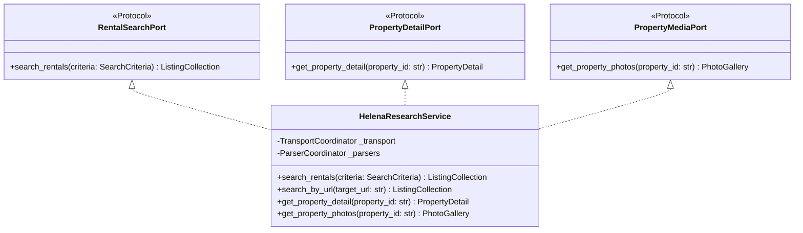

# Reverse-Engineered Rental Search API Documentation
**Target Domain**: `helenaimoveis.com.br`  
**Platform**: ImobiBrasil Platform Engine  
**Focus**: Rental Search, Supporting Metadata (Filters), Pagination, and Property Detail Retrieval  
**Status**: Completely reverse-engineered, validated, and reproducible without authentication.

---

## 1. System Overview & Architecture

Helena Imóveis operates on the **ImobiBrasil** real estate SaaS platform (`imobibrasil.app.br` / `cdn-imobibrasil.com.br`). The platform utilizes a server-side rendered PHP architecture behind Cloudflare CDN, providing SEO-friendly URL rewrites, semantic JSON-LD metadata, and AJAX media endpoints.



### Key Architectural Findings:
1. **Server-Side Rendered Listing Cards**: Unlike client-only AJAX portals, ImobiBrasil renders property cards directly into HTML (`<div class="imovelcard" data-link="...">`), while also emitting Google-compliant Schema.org JSON-LD (`RentAction`, `Product`, `Place`).
2. **Canonical SEO Routing & 302 Redirect Engine**: The system accepts legacy query strings at `/imovel/?...` and automatically issues HTTP 302 redirects to canonical RESTful hierarchical paths:
   `/imovel/{finalidade}/{tipo}/{cidade}/[bairro]/?&{querystring}`.
3. **Authentication Status**: **Completely Unauthenticated**. All search, filter, pagination, detail, and photo gallery endpoints are publicly accessible without authentication tokens, cookies, or CSRF tokens.
4. **Dual Photo Retrieval Channels**: Property photos are available both through the `#galeria-inicial` container in the detail HTML and via a lightweight JSON endpoint at `/t27/lista_imoveis_fotos.php?imovel={id}`.
5. **LLM/Agentic Support**: The site provides an `/llms.txt` document describing the agency context, CRECI registration (F0013267), and operational scope.
6. **HTTP Status Errors**: The client follows redirects and raises `PortalConnectionError` for all 4xx/5xx responses, including 404, so failed searches are never parsed as empty results. Nonexistent property IDs are documented to redirect to the homepage and become `PropertyNotFoundError`.

---

## 2. Target URL Deconstruction

**Target URL from Prompt**:
```text
https://www.helenaimoveis.com.br/imovel/locacao/todos/timoteo/?&dormitorios=2
```

### Path Segments & Query Mapping
| Segment / Query | Component Name | Value in Target URL | Description / Mapped Filter |
|---|---|---|---|
| Segment 1 | Root Route | `/imovel` | Base real estate directory controller |
| Segment 2 | Transaction Type (`finalidade`) | `locacao` | Filters exclusively for rental listings (`locacao` vs `venda` vs `todos`) |
| Segment 3 | Property Type (`tipo`) | `todos` | Category slug (`todos`, `apartamento`, `casa`, `comercial`, etc.) |
| Segment 4 | City Slug (`cidade`) | `timoteo` | Normalized city identifier |
| Path Suffix | Query Lead-in | `/?&` | ImobiBrasil standard SEO query separator |
| Query `dormitorios` | Bedroom Selector | `2` | Exact match for 2 bedrooms (use `22` for 2 or more) |

---

## 3. Detailed Endpoint Catalog

### 3.1. Rental Search Endpoint (Canonical SEO Route)

Executes property searches with full filtering and pagination.

- **URL**: `https://www.helenaimoveis.com.br/imovel/{finalidade}/{tipo}/{cidade}/[bairro]/`
- **Method**: `GET`
- **Headers**: Standard desktop `User-Agent` recommended
- **Query Parameters**: See Section 4 below
- **Response**: `text/html; charset=iso-8859-1` containing listing cards and pagination markup.

#### Example Request:
```http
GET /imovel/locacao/todos/timoteo/?&dormitorios=2 HTTP/2
Host: www.helenaimoveis.com.br
User-Agent: Mozilla/5.0 (X11; Linux x86_64) AppleWebKit/537.36
```

#### HTML Card Structure (`.imovelcard`):
```html
<div class="imovelcard" data-link="/imovel/4356012/apartamento-locacao-timoteo-mg-centro-norte">
  <div class="row">
    <a class="col imovelcard__img" href="/imovel/4356012/apartamento-locacao-timoteo-mg-centro-norte" 
       title="Apartamento para Locação, em Timóteo, bairro Centro Norte, 2 dormitórios, 1 banheiro, 1 vaga">
      
    </a>
    <div class="col imovelcard__infocontainer">
      <h2 class="imovelcard__info__tag">Locação</h2>
      <h2 class="imovelcard__info__local">Centro Norte, Timóteo / MG</h2>
      <p class="imovelcard__info__ref"><strong>Ref: 636</strong> - Apartamento</p>
      <div class="imovelcard__info__feature"><i class="fa fa-bed"></i><p><b>2</b><span>Dormitórios</span></p></div>
      <div class="imovelcard__info__feature"><i class="fa fa-shower"></i><p><b>1</b><span>Banheiro</span></p></div>
      <div class="imovelcard__info__feature"><i class="fa fa-car"></i><p><b>1</b><span>Vaga</span></p></div>
      <div class="imovelcard__valor__valor"><span>R$</span>1.200</div>
    </div>
  </div>
</div>
```

---

### 3.2. Form Search Gateway (Redirect Route)

Allows submitting flat key-value query parameters, automatically translated into canonical SEO paths.

- **URL**: `https://www.helenaimoveis.com.br/imovel/`
- **Method**: `GET`
- **Behavior**:
  - Submitting `GET /imovel/?finalidade=locacao&cidade=timoteo&dormitorios=2`
  - Responds with `302 Found`:
    `Location: /imovel/locacao/todos/timoteo/?&dormitorios=2`

---

### 3.3. Property Detail Endpoint

Retrieves complete property specifications, descriptions, and media.

- **Direct URL**: `https://www.helenaimoveis.com.br/imovel/{property_id}`
- **Canonical Slug URL**: `https://www.helenaimoveis.com.br/imovel/{property_id}/{slug}`
- **Method**: `GET`
- **Behavior**: Direct ID access `/imovel/4356012` returns HTTP 200 without redirecting.
- **Not Found Behavior**: Nonexistent property ID (e.g. `/imovel/999999999`) returns a 302 redirect to the homepage (`https://www.helenaimoveis.com.br/`).

#### Key Extracted Fields:
- **Title**: HTML `<title>` and Schema.org `Product.name`
- **Pricing**:
  - Base rent: `RentAction.price` (numeric, e.g. `1200.00`)
  - Condominium fee: `.info__tag` containing "Condomínio" (e.g. `R$ 500,00`)
  - IPTU: `.info__tag` containing "IPTU" (e.g. `145,00`)
- **Location**:
  - Street address: `PostalAddress.streetAddress` (e.g. `Rua 08 de Novembro, 5`)
  - Neighborhood: Extracted from title/header (e.g. `Centro Norte`)
  - City / State: `Timóteo` / `MG`
- **Specifications**:
  - Bedrooms, Suites, Bathrooms, Garages: `.info__tag` elements
- **Description**: `#desc_descricao p`
- **Amenities**: `.imovel_cx_caracteristicas .cxItem` (e.g. Móveis Planejados, Portão Eletrônico)

---

### 3.4. AJAX Photo Gallery Endpoint

Retrieves structured JSON list of all property gallery images.

- **URL**: `https://www.helenaimoveis.com.br/t27/lista_imoveis_fotos.php`
- **Method**: `GET`
- **Query Parameter**: `imovel={property_id}`
- **Response Format**: `application/json` (served as `text/html; charset=iso-8859-1`)

#### Sample Response:
```json
{
  "0": {
    "codigo_imo": "4356012",
    "arquivo_imm": "202609210945071833.jpeg"
  },
  "1": {
    "codigo_imo": "4356012",
    "arquivo_imm": "202609210945063888.jpeg"
  },
  "2": {
    "codigo_imo": "4356012",
    "arquivo_imm": "202609210945062125.jpeg"
  },
  "3": {
    "codigo_imo": "4356012",
    "arquivo_imm": "202609210945058774.jpeg"
  }
}
```

#### Media URL Construction:
Each image file is resolved by prefixing the filename with the media directory:
`https://www.helenaimoveis.com.br/imagens/imoveis/{arquivo_imm}`

---

## 4. Parameter Specification & Filter Mechanics

### 4.1. Path Parameters (Canonical Routing)
| Parameter | Permitted Values | Default | Purpose |
|---|---|---|---|
| `finalidade` | `locacao`, `venda`, `todos` | `locacao` | Transaction purpose |
| `tipo` | `todos`, `apartamento`, `casa`, `comercial`, `kitnet`, `loja`, `lote`, `pousada`, `cobertura`, `consultorio-medico`, `studio`, `casa-geminada` | `todos` | Property category |
| `cidade` | `todos`, `timoteo`, `coronel-fabriciano`, `ipatinga`, `santana-do-paraiso`, `nova-vicosa` | `todos` | City slug |
| `bairro` | Single neighborhood slug with numeric ID (e.g. `centro-norte-660978`) | Omitted | Optional single neighborhood in path |

### 4.2. Query Parameters
| Query Key | Type | Example Values | Description / Behavior |
|---|---|---|---|
| `dormitorios` | integer code | `1`-`5` (exact)<br>`21`-`25` (N or more) | `2` = exactly 2 bedrooms<br>`22` = 2 or more bedrooms |
| `suites` | integer code | `1`-`5` (exact)<br>`21`-`25` (N or more) | `1` = 1 suite<br>`21` = 1 or more suites |
| `banheiros` | integer code | `1`-`5` (exact)<br>`21`-`25` (N or more) | `1` = 1 bathroom<br>`21` = 1 or more bathrooms |
| `vagas` | integer code | `1`-`5` (exact)<br>`21`-`25` (N or more) | `1` = 1 parking spot<br>`21` = 1 or more parking spots |
| `vmi` | integer | `1000` | Minimum rental price in BRL ("Valor Mínimo") |
| `vma` | integer | `2500` | Maximum rental price in BRL ("Valor Máximo") |
| `areaMinima` | integer | `50` | Minimum area in m² |
| `areaMaxima` | integer | `200` | Maximum area in m² |
| `bairros` | comma-separated IDs | `660978,69652` | Multi-neighborhood filter supported by `imobi-bairros-multi.js` |
| `ord` | string | `menor_valor`<br>`maior_valor`<br>`recentes` | Sorting order (`""` = default, `menor_valor` = price asc, `maior_valor` = price desc) |
| `pag` | integer | `1`, `2`, `3`... | 1-indexed pagination number |
| `ref` | string | `636` | Reference code search |
| `reftipo` | string | `exata` | Reference match type (`exata` = exact match) |

---

## 5. Pagination Mechanics

- **Page Size**: Exactly **15 items per page**.
- **Query Parameter**: `pag=N` (1-indexed).
- **Navigation HTML**: Rendered inside `<div class="lista_imoveis_paginacao">`.
- **Termination Condition**:
  - When `pag` exceeds the total number of pages, the server returns HTTP 200 with 0 property cards.
  - Presence of subsequent pages is indicated by `>` or page numbers greater than current page in the pagination markup.

---

## 6. Central Rental Research MCP Boundary Interface

The reverse-engineered capabilities are structured as a clean Python library for direct integration into a central Model Context Protocol (MCP) server.



### Module Organization:
- `helena_research.domain`: Primitives, Value Objects (`PriceRange`, `RoomCount`, `PageNumber`), Enums (`PropertyType`, `SortOrder`), Entities (`ListingSummary`, `PropertyDetail`), Collections (`ListingCollection`, `PhotoGallery`), and Domain Exceptions.
- `helena_research.infrastructure`: HTTP Client (`HttpxHttpClient`) and URL Constructor (`UrlBuilder`).
- `helena_research.parsers`: High-performance BeautifulSoup parsers (`ListingParser`, `DetailParser`, `PhotoParser`).
- `helena_research.application`: Service facade (`HelenaResearchService`) implementing clean ports (`RentalSearchPort`, `PropertyDetailPort`, `PropertyMediaPort`).
