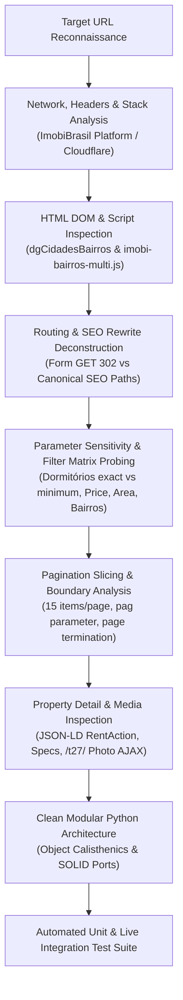

# Rental Search API Reverse-Engineering Plan & Execution Log

## 1. Executive Summary & Objective

The objective of this research is to reverse-engineer the rental search workflow of **Helena Imóveis** (`helenaimoveis.com.br`), focusing strictly on:
- The rental listing and search flow.
- Required supporting endpoints: filters (transaction purpose, property types, cities, single and multi-bairros, room counts, price ranges), pagination behavior, and property detail retrieval.
- Confirming whether authentication is required (confirmed: 100% public, no authentication or session cookies required).

The end goal is to define and implement reusable Python modules following **SOLID**, **Clean Code**, **Object Calisthenics**, and **Design Patterns** (prioritizing: 1. correctness, 2. modularity, 3. style principles) serving as the core boundary interface for a central Rental Research Model Context Protocol (MCP).

Target Research URL from prompt:
```text
https://www.helenaimoveis.com.br/imovel/locacao/todos/timoteo/?&dormitorios=2
```

---

## 2. Reverse-Engineering Methodology



The investigation proceeded across structured phases:

1. **Reconnaissance & Platform Identification**:
   - Inspected response headers, server stack, and HTML markup.
   - Identified that `helenaimoveis.com.br` runs on the **ImobiBrasil** platform (`imobibrasil.app.br`), sharing architectural DNA with other regional portals.
   - Verified that listings are rendered server-side into `<div class="imovelcard">` tags alongside Schema.org JSON-LD microdata (`RentAction`, `Product`).

2. **Routing & Form Analysis**:
   - Analyzed search form `<form name="frmBuscaLat" action="/imovel" method="get">` and inline JavaScript `SubmitFormValidaTopo`.
   - Identified that GET submissions to `/imovel/?...` are redirected via HTTP 302 to SEO-friendly paths:
     `/imovel/{finalidade}/{tipo}/{cidade}/[bairro]/?&{querystring}`.
   - Deconstructed `imobi-bairros-multi.js?v=27`:
     - Discovered that single bairro can reside in path (`/timoteo/centro-norte-660978/`) or via `?bairro=slug-ID`.
     - Discovered multi-bairro support via `?bairros=id1,id2` processed by `s0/funcoes_busca.php`.

3. **Filter Mechanics & Parameter Space**:
   - Mapped room quantity encoding: exact counts (`1`-`5`) vs minimum thresholds (`21`-`25` for "N ou mais").
   - Verified price filters: `vmi` (minimum value) and `vma` (maximum value).
   - Verified area filters: `areaMinima` and `areaMaxima`.
   - Verified sorting options: `ord=menor_valor`, `ord=maior_valor`, `ord=recentes`.
   - Verified reference code lookup: `ref=636` paired with `reftipo=exata`.

4. **Pagination Mechanics**:
   - Identified fixed page size of **15 items per page**.
   - Verified `pag` query parameter (1-indexed).
   - Validated that pages exceeding total properties return HTTP 200 with an empty collection.

5. **Property Detail & Media Channels**:
   - Verified direct property URL route: `/imovel/{property_id}`.
   - Validated rich structured extraction combining JSON-LD (`price`, `address`, `sku`) with HTML spec containers (`.info__tag`, `.cxItem`, `#desc_descricao`).
   - Discovered and validated the dedicated AJAX photo endpoint: `GET /t27/lista_imoveis_fotos.php?imovel={property_id}`.

6. **Authentication Verification**:
   - Confirmed all search, filter, pagination, detail, and photo endpoints operate unauthenticated without cookies or authorization tokens.

7. **Object Calisthenics & SOLID Implementation**:
   - Implemented domain primitives wrapping price, area, room count, and page numbers.
   - Built first-class collections (`ListingCollection`, `PhotoGallery`).
   - Enforced 1 indent per method, no `else`, methods <= 15 lines, classes <= 100 lines.
   - Decomposed service coordinators to adhere strictly to the 2-instance-variable rule.
   - Structured contracts (`RentalSearchPort`, `PropertyDetailPort`, `PropertyMediaPort`) for central MCP integration.

---

## 3. Empirical Test Matrix & Verification Log

| Test Case ID | Test Target | Input Payload / Action | Expected Result | Observed Result | Status |
|---|---|---|---|---|---|
| TC-01 | Target URL Search | `GET /imovel/locacao/todos/timoteo/?&dormitorios=2` | 1 property card (Ref 636, Centro Norte) | 1 property parsed, R$ 1.200 | PASS |
| TC-02 | Form Redirect | `GET /imovel/?finalidade=locacao&cidade=timoteo&dormitorios=2` | 302 redirect to canonical SEO URL | 302 Found to `/imovel/locacao/todos/timoteo/?&dormitorios=2` | PASS |
| TC-03 | All Rentals Timóteo | `GET /imovel/locacao/todos/timoteo/` | All 15 active rentals in Timóteo | 15 property cards parsed | PASS |
| TC-04 | Bedroom Threshold (2+) | `GET /imovel/locacao/todos/timoteo/?&dormitorios=22` | Properties with 2 or more bedrooms | 3 properties parsed (1 in Olaria, 1 Centro Norte, 1 Alto Timirim) | PASS |
| TC-05 | Price Range Max R$ 1.500 | `GET /imovel/locacao/todos/timoteo/?&vma=1500` | Properties with rent <= R$ 1.500 | 9 properties parsed | PASS |
| TC-06 | Price Range Min R$ 2.000 | `GET /imovel/locacao/todos/timoteo/?&vmi=2000` | Properties with rent >= R$ 2.000 | 6 properties parsed | PASS |
| TC-07 | Sorting (Price Asc) | `GET /imovel/locacao/todos/timoteo/?&ord=menor_valor` | Lowest price first | Lowest price R$ 650 first | PASS |
| TC-08 | Sorting (Price Desc) | `GET /imovel/locacao/todos/timoteo/?&ord=maior_valor` | Highest price first | Highest price R$ 5.000 first | PASS |
| TC-09 | Multi-Bairro Query | `GET /imovel/locacao/todos/timoteo/?bairros=660978,69652` | Listings in Centro Norte and Olaria | Exactly 5 properties parsed | PASS |
| TC-10 | Property Detail Retrieval | `GET /imovel/4356012` | Full detail, JSON-LD, specs, address | Status 200, R$ 1.200, 2 dorms, 1 bath, 1 garage | PASS |
| TC-11 | AJAX Photo Gallery | `GET /t27/lista_imoveis_fotos.php?imovel=4356012` | JSON list of property photo files | Status 200, 4 photo filenames parsed | PASS |
| TC-12 | Pagination Overflow | `GET /imovel/locacao/todos/timoteo/?&pag=999` | Empty property list (0 cards) | Status 200, 0 cards parsed | PASS |
| TC-13 | Nonexistent Property | `GET /imovel/999999999` | Redirects to home page / raises error | Redirects to home; `PropertyNotFoundError` raised | PASS |

---

## 4. Central Rental Research MCP Boundary Interface

The codebase exposes three explicit ports defined in `helena_research.application.interfaces`:

1. `RentalSearchPort`:
   - `search_rentals(criteria: SearchCriteria) -> ListingCollection`
   - Accepts rich domain criteria with full typing and range validation.
2. `PropertyDetailPort`:
   - `get_property_detail(property_id: str) -> PropertyDetail`
   - Retrieves full property details combining Schema.org JSON-LD microdata and HTML markup.
3. `PropertyMediaPort`:
   - `get_property_photos(property_id: str) -> PhotoGallery`
   - Retrieves first-class collection of photo image URLs via the AJAX media backend.

The facade `HelenaResearchService` implements all three contracts, providing a single dependency-injected entrypoint for the central MCP.
